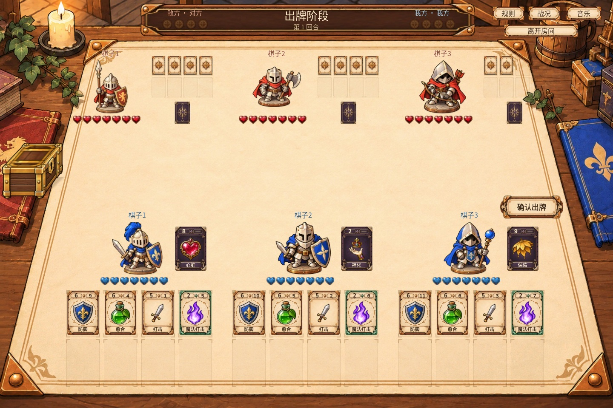

# 牺牲 · Sacrifice

《牺牲》是一款双人回合制卡牌策略游戏。每名玩家控制三个棋子，为它们分别安排出牌，再按卡牌优先级依次结算。击败敌方全队，或集齐四枚胜利徽章，即可赢得对局。

棋子阵亡后仍可能通过亡语复活、改变资源或获得徽章。有时，留住一个濒死的敌人，比立刻击杀它更有利。

**[浏览器游玩](https://sacrifice.shytomato.top/)** · **[观看玩法演示](docs/demo.md)** · **[完整规则介绍](docs/rules.md)**

> **开发中**：目前提供开发测试版，规则、卡牌和界面仍在调整。移动端 Safari 偶发崩溃仍在排查；线上版本可能晚于仓库中的最新修改。

## 开始游戏

打开[网页版](https://sacrifice.shytomato.top/)，等待资源加载后进入游戏。建议优先使用电脑浏览器，手机请横屏游玩。

- **和朋友对战**：输入昵称，创建房间，将房间号或邀请链接发给朋友；对方加入后开局。
- **单人练习**：在大厅选择「本地 AI 对战」。另有「自学习 AI 对战（实验）」入口；使用的是离线训练后的策略，对局时不会调用在线大模型。
- **查看说明**：鼠标移到卡牌或状态图标上可查看效果；对局右上角的「规则」和「战况」分别提供规则介绍与结算记录。

暂未发布与仓库当前版本对应的桌面安装包。希望在本机运行的玩家，可以按下方说明使用 Godot 打开工程。

## 基础玩法与规则

### 棋子与卡牌

- 双方各有 **3 个棋子**。每个棋子独立持有手牌和亡语牌，基础最大生命为 **7**，手牌上限为 **8**。
- 开局每个棋子获得 **4 张手牌和 1 张亡语牌**，之后照常摸第一回合的牌，通常首次出牌时有 5 张手牌。
- 普通牌分为攻击牌和技能牌。牌面左上角为主优先级，右上角为次优先级。
- 亡语牌通常在棋子阵亡后的亡语阶段触发。特殊效果以具体卡牌说明为准。

### 每回合的流程

| 阶段 | 玩家需要做什么 |
| --- | --- |
| **出牌阶段** | 正常情况下每个存活棋子摸 1 张牌，可出 1 张，也可不出。点击手牌出牌，点击已出的牌撤回；双方都确认后进入结算。确认前，对方看不到你选了什么牌。 |
| **结算阶段** | 按主优先级从高到低分批翻牌，再按次优先级从高到低结算。同一批牌结算完，才翻开下一批。需要指定目标时，由对应玩家选择。 |
| **亡语阶段** | 本回合阵亡、且轮到其亡语时仍然阵亡的棋子，按亡语优先级依次触发效果。复活会取消尚未触发的亡语；没有需要执行的动作时直接跳过这一阶段。 |

棋子阵亡后，尚未结算的普通牌通常不再生效；明确允许死亡时触发的效果除外。已经使用的一次性亡语牌会留在原位并标记「已触发」，方便回看。

### 获胜方式

**集齐 4 枚胜利徽章，或在相关结算完成后使敌方三个棋子全部阵亡。**

全灭并不总会立刻结束游戏：尚待处理的亡语可能复活棋子，或让另一方先集齐徽章。例如，「取义」在持有者有存活队友时可以获得两枚胜利徽章，因此击杀顺序也会影响胜负。

更多内容见[完整规则介绍](docs/rules.md)。截至 2026-10-21，游戏包含 **60 种普通牌、128 张初始牌库卡牌和 20 种亡语牌**；巨石、毒药等效果生成的诅咒牌另计。

## 玩法演示

[观看或下载演示视频](docs/media/sacrifice-gameplay-demo.mp4)。视频展示出牌、优先级结算，以及面对「取义」时的两种选择。画面由当前游戏工程录制，使用预设局面；[录制说明](docs/demo.md)包含演示范围与素材署名。

## 从源码运行

项目使用 **Godot / GDScript**，当前验证的编辑器版本为 **Godot 4.7.1**。

1. 克隆或下载本仓库。
2. 在 Godot 项目管理器中导入根目录的 `project.godot`。
3. 等待资源导入完成，运行项目，进入本地 AI 对战即可单人游玩。

本地 AI 对战无需连接游戏服务器。自行运行源码不等于启动公网房间服务；与朋友联机可以使用上方的网页版入口。

## 开发与反馈

目前继续打磨移动端稳定性、卡牌平衡和操作反馈。反馈问题时，请尽量附上设备与浏览器、发生阶段、相关卡牌及复现步骤；「战况」中的记录也有助于定位问题。

| 资料 | 内容 |
| --- | --- |
| [设计与开发案例](docs/cases/README.md) | 亡语决策、AI 平衡测试与体验迭代 |
| [历史开发记录](docs/development-history.md) | 规则、交互和表现的历次调整 |
| [普通牌数据](data/cards.json) / [亡语牌数据](data/deathrattles.json) | 当前卡牌定义 |
| [规则实现](scripts/rules.gd) / [测试目录](tests) | 回合流程、效果结算与验证 |

## 制作与素材

项目由 **HongyiSi** 发起并设计，使用 AI 辅助编程与素材制作。音乐、音效和字体等外部素材的作者、来源与许可分别记录在下方文件中。

[音乐署名与许可](assets/music/CREDITS.md) · [音效署名与许可](assets/sfx/CREDITS.md) · [字体说明](assets/fonts/README.md)
