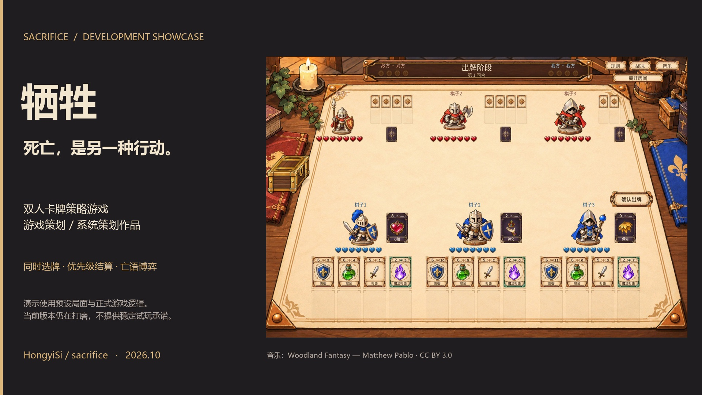

# 开发中演示视频

[返回首页](../README.md) · [观看 / 下载 MP4](media/sacrifice-system-design-demo.mp4)

**59 秒 · 1920 × 1080 · 30 FPS · H.264 / AAC · 约 5.2 MiB。**

这是一份面向游戏策划 / 系统策划岗位的玩法演示。所有对局画面来自当前 Godot 工程；手牌与局面经过预设，输入由脚本执行，伤害、亡语、徽章和结局由正式规则引擎计算。片中没有真人旁白，侧栏文字解释决策与结果，背景音乐来自游戏。

当前版本仍在打磨。视频不代表稳定试玩版，不代表完整随机对局，也不是平衡性或 AI 胜率的证明。

## 分镜与屏幕文字

| 章节 | 内容 | 想回答的问题 |
| --- | --- | --- |
| 开场 | “死亡，是另一种行动。”；双人策略、开发中标识 | 作品的核心体验是什么？ |
| 01 同时决策 | 三枚棋子、独立手牌，选牌并确认 | 玩家如何组织行动？ |
| 02 结算顺序 | 打击与魔法打击按优先级分批翻开、结算 | 速度和伤害如何形成取舍？ |
| 03 核心取舍 | 对方已有两枚徽章；击杀公开的取义持有者，使其达成四枚徽章 | 为什么有时不能立刻击杀？ |
| 04 对照选择 | 回到相同局面，攻击另一棋子，保留对局 | 玩家有哪些可行替代？ |
| 结尾 | “把设计问题变成可验证的局面。” | 后续案例如何提供证据？ |

两个分支由录制脚本断言结局；完整片段时间线见 [demo-timeline.json](evidence/demo-timeline.json)。等待选择的部分缩短为固定停留时间；效果动画仍采用游戏内时长。屏幕侧栏、片头和片尾为视频包装，不属于游戏界面。

## 素材来源

- 游戏画面、卡面和动画：本仓库当前工程直接渲染，没有用生成式视频替代游戏运行结果。
- 音乐：[Woodland Fantasy — Matthew Pablo](https://opengameart.org/content/woodland-fantasy)，作者 [Matthew Pablo](https://www.matthewpablo.com/)，[CC BY 3.0](https://creativecommons.org/licenses/by/3.0/)。视频截取片段，调整音量并添加淡入淡出；不暗示作者对本项目背书。
- 包装文字使用制作电脑上的 Microsoft YaHei；仓库不分发该字体文件。跨平台重制需替换为本机可用的中文字体。
- 游戏内字体、音效的许可见[音乐](../assets/music/CREDITS.md)、[音效](../assets/sfx/CREDITS.md)和[字体](../assets/fonts/README.md)说明。

## 复现与检查

录制源文件与参数化工具保存在 [demo-source](demo-source/README.md)。工程需要先完成 Godot 资源导入。原始逐帧图片属于制作中间文件，不上传仓库；成片与封面可直接读取。

本次检查包括：两个规则分支的结果断言、成片完整解码、关键时点画面与转场检查、音轨存在性和峰值检查。音轨峰值约 −13.2 dBFS；未进行手机端视频播放器兼容性实测。

GitHub 页面不能直接播放时，可下载 MP4 后观看；当前仓库的可见性不会因这份作品页自动改变。
