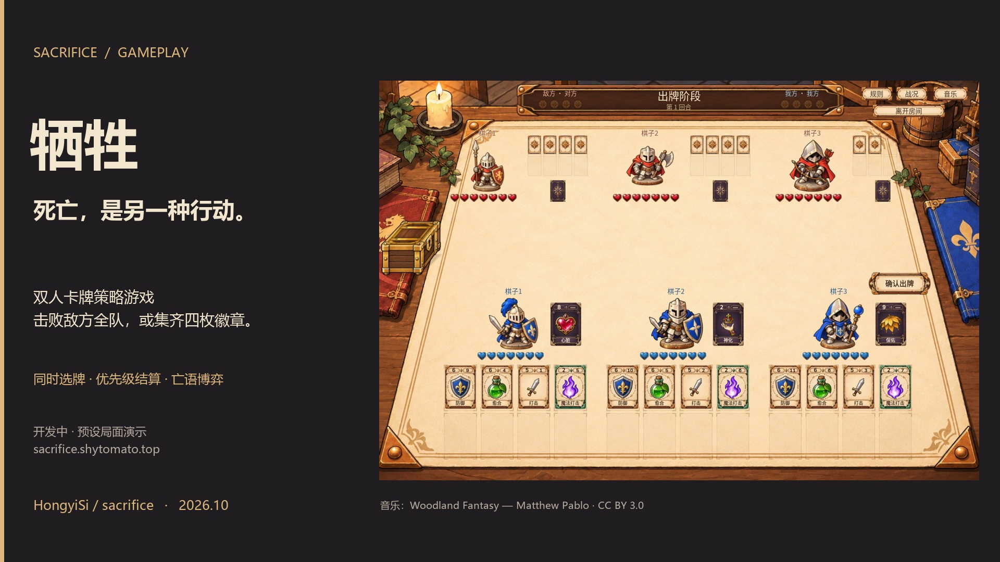

# 开发中演示视频

[返回首页](../README.md) · [观看 / 下载 MP4](media/sacrifice-gameplay-demo.mp4)

**约 56 秒 · 1920 × 1080 · 30 FPS · H.264 / AAC。**

这是一份介绍《牺牲》基础玩法的短视频。所有对局画面来自 Godot 工程；手牌与局面经过预设，输入由脚本执行，伤害、亡语、徽章和结局由正式规则引擎计算。片中没有真人旁白，侧栏文字解释玩法与结果。音轨包含游戏背景音乐，以及与画面同步的出牌、挥剑、命中、魔法打击、阵亡和胜利徽章音效。

当前版本仍在打磨。视频不代表稳定试玩版，不代表完整随机对局，也不是平衡性或 AI 胜率的证明。

## 分镜与屏幕文字

| 章节 | 内容 | 想回答的问题 |
| --- | --- | --- |
| 开场 | “死亡，是另一种行动。”；双人策略、开发中标识 | 作品的核心体验是什么？ |
| 01 同时决策 | 三枚棋子、独立手牌，选牌并确认 | 玩家如何组织行动？ |
| 02 结算顺序 | 打击与魔法打击按优先级分批翻开、结算 | 速度和伤害如何形成取舍？ |
| 03 核心取舍 | 对方已有两枚徽章；击杀公开的取义持有者，使其达成四枚徽章 | 为什么有时不能立刻击杀？ |
| 04 对照选择 | 回到相同局面，攻击另一棋子，保留对局 | 玩家有哪些可行替代？ |
| 结尾 | “击杀之前，想想它的亡语。”；网页入口 | 去哪里体验游戏？ |

两个分支由录制脚本断言结局；完整片段时间线见 [demo-timeline.json](evidence/demo-timeline.json)。时间线中的帧号对应游戏片段，换算成成片时间时需加上 4 秒片头。等待选择的部分缩短为固定停留时间；效果动画按游戏内各阶段时长采样，最多有半帧的取整误差。屏幕侧栏、片头和片尾为视频包装，不属于游戏界面。

## 本次重录

旧录制脚本只修改特效的 `elapsed` 字段，随后调用的逐帧更新又用真实时钟覆盖了这个值，导致飞剑、魔法弹等效果跳到结束状态。新版直接用采样时间驱动正式特效的 `present(seconds)` 方法，并先更新卡牌的位置，再计算特效的起点。打击的抬剑、飞行、命中以及魔法打击的飞行、爆开过程均保留在成片中。

这次修正的是录制工具，没有修改游戏中的动画、卡牌效果或伤害数值。旧视频保留在本地输出归档；首页和案例中的视频链接统一指向重录版。

2026-10-22 补充声音：保留上述视频的全部画面，使用正式游戏的音效调度导出 16 个声音事件，并按视频采样时间混合。出牌落点、剑的飞行与接触、魔法命中和两枚徽章依次到位均采用游戏原有音效。配乐在音效出现时平滑降低音量，随后恢复；需要随动画阶段停止的声音保留原有截断规则。声音时间线见 [demo-audio.json](evidence/demo-audio.json)。

## 素材来源

- 游戏画面、卡面和动画：本仓库当前工程直接渲染，没有用生成式视频替代游戏运行结果。
- 音乐：[Woodland Fantasy — Matthew Pablo](https://opengameart.org/content/woodland-fantasy)，作者 [Matthew Pablo](https://www.matthewpablo.com/)，[CC BY 3.0](https://creativecommons.org/licenses/by/3.0/)。视频截取片段，调整音量、添加淡入淡出，并在音效播放时压低配乐；不暗示作者对本项目背书。
- 卡牌音效：直接使用仓库中的卡牌移动、攻击、同步挥剑和徽章音效，来源与许可见[音效署名](../assets/sfx/CREDITS.md)。混音调整整体音量并按动画安排播放时间，没有替换为通用配音或重新生成声音。
- 包装文字使用制作电脑上的 Microsoft YaHei；仓库不分发该字体文件。跨平台重制需替换为本机可用的中文字体。
- 游戏内字体、音效的许可见[音乐](../assets/music/CREDITS.md)、[音效](../assets/sfx/CREDITS.md)和[字体](../assets/fonts/README.md)说明。

## 复现与检查

录制源文件与参数化工具保存在 [demo-source](demo-source/README.md)。工程需要先完成 Godot 资源导入。原始逐帧图片属于制作中间文件，不上传仓库；成片与封面可直接读取。

本次检查包括：对攻与两个亡语分支的结果断言、特效采样时间与运动轨迹检查、成片完整解码、飞剑与魔法弹的连续帧检查，以及桌面浏览器的播放验证。补充音效后再次核对了全部 54 段画面的时间线、16 个声音事件、压缩后音轨和峰值；视频画面流与旧版相同，成片没有削波，桌面浏览器可正常有声播放。验证记录见 [demo-audio-checks.json](evidence/demo-audio-checks.json)。未进行手机端视频播放器兼容性实测。

GitHub 页面不能直接播放时，可下载 MP4 后观看；当前仓库的可见性不会因这份作品页自动改变。
